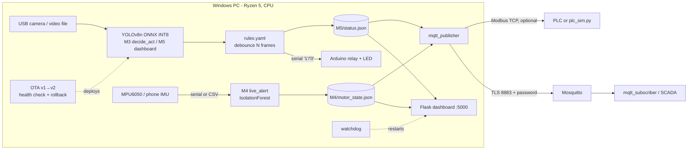

# Edge AI & Embedded Vision - "ir case" inspection cell

Reference project on a Windows PC (Ryzen 5, CPU only). A camera watches my own 3D-printed IR-sensor
enclosure ("ir case"); a YOLOv8n model (ONNX INT8) detects `case_closed`, `case_open` and a loose `lid`;
a debounced rule drives an Arduino relay/LED; an MPU6050 on the motor feeds an IsolationForest anomaly
model; results go over MQTT (TLS + password), optionally to a PLC (Modbus TCP), and to a Flask dashboard.

**Every number in this repo must come from running these scripts on this machine.** The templates in
each `M?/docs/` folder have blank result fields on purpose; the `*_filled.md` files next to them hold the
measured values. The scripts write their results to files (`M1/results/m1_metrics.json`,
`M2/results/m2_results.csv`, `M3/results/m3_summary.json`, `M4/results/m4_false_alarms.csv`, `M5/results/m5_eval_summary.json`, `M5/results/m5_soak_summary.json`)
and `python M5/headline.py` shows only what those files contain.

## Architecture



## Folder map

One folder per milestone. Each has its scripts at the top, `results/` (files the scripts wrote on this PC)
and `docs/` (blank template + `*_filled.md` with the measured values). See the README inside each folder.

```
M1/  data + first model     extract_frames, autolabel, split_dataset, overlay_baseline, train_eval, annotate_test
     results/  m1_metrics.json, m1_errors.csv, m1_baseline_*        docs/  data card, error analysis
M2/  optimise               export_benchmark
     results/  m2_results.md/.csv                                   docs/  M2 target, results
M3/  decide + act           decide_act, rules.yaml, arduino_relay.ino
     results/  m3_summary.json, m3_events.csv, m3_fps.csv           docs/  decision rules
M4/  motor, comms, ops      anomaly (train/live/false alarms/drift), phyphox import, MQTT, PLC, OTA, watchdog
     results/  m4_mqtt_auth_test.json (+ motor results when run)    docs/  threat model
M5/  integrate + prove      dashboard, eval_parts, soak_test, verdict_check, headline, autostart/
     results/  m5_soak_*.json/.csv                                  docs/  autostart test record
common/   shared by M3 + M5: onnx_detector, rules_engine (FAIL / NO PART / PASS), atomic_json
```
Run every command from the repository root (paths like `M3/rules.yaml` are relative to it).

## Setup (Windows)

onnxruntime has no wheel for Python 3.15, so use Python 3.12. Keep the venv at a short path
(deep project paths break pip on Windows' 260-character limit).

```bat
py install 3.12
py -3.12 -m venv %LOCALAPPDATA%\edgeai-venv
%LOCALAPPDATA%\edgeai-venv\Scripts\activate
pip install torch torchvision --index-url https://download.pytorch.org/whl/cpu
pip install -r requirements.txt
```

Runtime inference uses `common/onnx_detector.py` (onnxruntime directly, explicit thread budget per stream);
on this CPU the ultralytics `predict()` wrapper was about 2x slower for the same model and outputs.

Hardware: Arduino Uno/Nano for the relay (`M3/arduino_relay.ino`, relay on pin 7, LED pin 13) and for the
MPU6050 (`M4/mpu6050_stream.ino`, SDA A4, SCL A5). Mosquitto for M4: install from mosquitto.org.
Find your COM port in Device Manager → Ports.

## Run order

### M1 - data, baseline, first model
```bat
python M1\extract_frames.py clips\a.mp4 clips\b.mp4 clips\c.mp4 clips\d.mp4 clips\e.mp4 clips\f.mp4 --every 10
:: label: either Roboflow/CVAT/LabelImg (YOLO .txt next to each .jpg), or propose + review:
python M1\autolabel.py propose --clip a --cls case_closed
python M1\autolabel.py propose --clip d --two
python M1\autolabel.py sheet --clip a          :: look at review\a_*.jpg
python M1\autolabel.py exclude --clip a --frames 000000 000010   :: move bad frames aside (recoverable)
:: clip d was cut into time segments d1/d2/d3 (with gaps) so every split has open-case/lid frames
python M1\split_dataset.py --train a b d1 e --val d2 d3 --test c f
python M1\overlay_baseline.py --source clips\c.mp4                      :: contour baseline
python M1\train_eval.py --epochs 50
python M1\annotate_test.py                     :: boxes on every test image -> test_annotated\
```
Clips: a-d first recording session; e = closed case filmed top-down, f = closed then opened + loose lid
(e and f were added after v1 missed top-down closed cases). Test clips c and f are never trained on.
Fill `M1/docs/data_card.md` and `M1/docs/m1_error_analysis.md` (10 rows from `M1/results/m1_errors.csv`).

### M2 - optimise
Fill `M2/docs/m2_target.md` **first**, then:
```bat
python M2\export_benchmark.py --weights runs\detect\train\weights\best.pt --data dataset\data.yaml --calib dataset\images\val
```

### M3 - decide and act
Edit `M3/rules.yaml`, justify it in `M3/docs/decision_rules.md`, flash `M3/arduino_relay.ino`.
```bat
python M3\decide_act.py --model models\best_int8.onnx --sources clips\c.mp4 clips\a.mp4
python M3\decide_act.py --model models\best_int8.onnx --sources 0 --serial COM5
docker build -t edgeai . && docker run --rm edgeai
```

### M4 - motor, comms, security, operations
```bat
:: data option A - phone IMU (no Arduino): record 60 s runs in phyphox (raw Accelerometer [+ Gyroscope]),
::   export CSV zips named normal_1..3, normal_11..15, fault_1.. into M4\phone_raw\, then ONE command:
python M4\run_motor_pipeline.py
:: data option B - MPU6050 (flash M4\mpu6050_stream.ino first)
python M4\mpu_logger.py --port COM5 --label normal --run 1 --seconds 60     :: runs 1-3 = training
python M4\mpu_logger.py --port COM5 --label normal --run 11 --seconds 60    :: runs 11-15 = false-alarm test
python M4\mpu_logger.py --port COM5 --label fault  --run 1 --seconds 60
python M4\train_anomaly.py --files M4\data\normal_1.csv M4\data\normal_2.csv M4\data\normal_3.csv --fault-files M4\data\fault_1.csv
python M4\live_alert.py --port COM5
python M4\false_alarm_counter.py --files M4\data\normal_11.csv M4\data\normal_12.csv M4\data\normal_13.csv M4\data\normal_14.csv M4\data\normal_15.csv
python M4\drift_check.py --files M4\data\normal_20.csv

:: MQTT with TLS + password
python M4\mosquitto\gen_certs.py
mosquitto_passwd -c M4\mosquitto\passwd edgeai
mosquitto -c M4\mosquitto\mosquitto.conf -v
set MQTT_USER=edgeai
set MQTT_PASS=<your password>
python M4\test_mqtt_auth.py             :: no-password client must be refused
python M4\mqtt_subscriber.py
python M4\mqtt_publisher.py

:: optional PLC
python M4\plc_sim.py
python M4\plc_write.py --reject 1 --motor-alert 0 --score 0.123 --readback

:: operations
python M4\ota\demo_ota.py
python M4\watchdog.py --max-restarts 5 -- python M4\crash_demo.py
```
Fill `M4/docs/threat_model.md` with the test results.

### M5 - integrate and prove
```bat
python M5\dashboard.py --model models\best_int8.onnx --source 0          :: http://127.0.0.1:5000
python M5\eval_parts.py --model models\best_int8.onnx --manifest M5\parts_manifest.csv
python M5\soak_test.py --model models\best_int8.onnx --source clips\c.mp4 --minutes 10
python M5\soak_report.py                      :: FPS / memory per period of the soak
python M5\live_session_report.py --since "2026-11-13 12:46:00"   :: timeline from the MQTT subscriber log
python M5\headline.py
:: auto-start: edit paths in M5\autostart\start_edgeai.bat and edgeai_task.xml, then
schtasks /Create /TN "EdgeAI" /XML M5\autostart\edgeai_task.xml
```
Linux: `M5/autostart/edgeai.service` (instructions in the file).

## Status

| Milestone | State |
|---|---|
| M1 data + model | done (v2 model with clips e/f); results in `M1/results/m1_metrics.json`, error list in `M1/results/m1_errors.csv` |
| M2 optimise | done; `M2/results/m2_results.md` (measured on AC power - battery throttles the CPU) |
| M3 decide + act | done with the on-screen LED actuator; Arduino relay run pending (hardware) |
| M4 motor anomaly | code ready; **pending real vibration recordings** (phone/phyphox or MPU6050) |
| M4 MQTT / PLC / OTA / watchdog | done and tested (TLS + password, no-password refused, PLC simulator, rollback, restart) |
| M5 dashboard / soak / autostart | done; power-cycle evidence in `M5/docs/m5_autostart_test.md` |
| M5 20-part evaluation | **pending: record 20 part clips** and fill `M5/parts_manifest.csv` |

Station verdict: **FAIL** (5 bad frames in a row) > **NO PART** (5 frames with no detection; `no_part` in
`M3/rules.yaml`) > **PASS**. Check any clip offline with `python M5/verdict_check.py clips/f.mp4`.

Filled-in reports from the measured results sit next to each template as `*_filled.md`:
[M1 data card](M1/docs/data_card_filled.md), [M1 error analysis](M1/docs/m1_error_analysis_filled.md),
[M2 results](M2/docs/m2_results_filled.md), [M3 decision rules](M3/docs/decision_rules_filled.md),
[M4 threat-model tests](M4/docs/threat_model_filled.md).

Not in this repository (see `.gitignore`): videos, extracted frames, trained models, the broker password
file and TLS keys. Re-create them with the commands above.

## Templates (blank - fill from your own runs)

- [Data card](M1/docs/data_card.md)
- [Decision-rule sheet](M3/docs/decision_rules.md)
- [M2 target](M2/docs/m2_target.md)
- [Threat model](M4/docs/threat_model.md)
- [M1 error analysis](M1/docs/m1_error_analysis.md)
- [M5 auto-start test record](M5/docs/m5_autostart_test.md)

## Results

| Headline metric | Value | Source file |
|---|---|---|
| M1 test mAP@0.5 | | M1/results/m1_metrics.json |
| M2 INT8 CPU median latency (ms) | | M2/results/m2_results.csv |
| M3 frame→actuator median / p95 (ms) | | M3/results/m3_summary.json |
| M4 false alarms over 5 normal runs | | M4/results/m4_false_alarms.csv |
| M5 false-pass rate (20 parts) | | M5/results/m5_eval_summary.json |
| M5 10-min soak: errors / mean FPS | | M5/results/m5_soak_summary.json |
